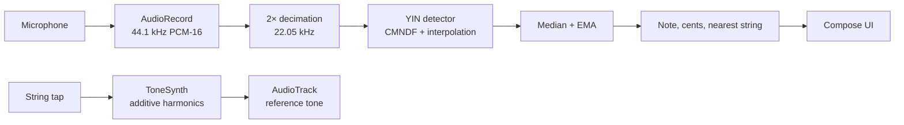

<div align="center">

# Tuner

**A guitar tuner for Android, built with Material 3 Expressive.**

[](https://kotlinlang.org/)
[](https://developer.android.com/)
[](https://developer.android.com/jetpack/compose)
[](https://m3.material.io/)
[](https://gradle.org/)
[](https://developer.android.com/)
[](https://github.com/andreasmlbngaol/Tuner/releases)
[](https://github.com/andreasmlbngaol/Tuner/actions/workflows/release.yml)

</div>

Tuner listens to the microphone, finds the pitch of the plucked string, and
shows how far it is from the target note. String mode covers seven guitar
tunings and can follow the string being played or hold a manual target.
Chromatic mode works for any note.

The interface uses `MaterialExpressiveTheme`, `MotionScheme.expressive()`, the
emphasized type scale, and large rounded surfaces. On Android 12 and newer the
palette follows the wallpaper; otherwise a warm amber palette is used.

## Contents

- [What it does](#what-it-does)
- [Stack](#stack)
- [How it works](#how-it-works)
- [Project layout](#project-layout)
- [Running it](#running-it)
- [Using the app](#using-the-app)
- [Design notes](#design-notes)
- [Privacy](#privacy)
- [License](#license)

## What it does

- **String mode.** Six strings, a large dial, and a direction indicator. The
  target note and its frequency are shown in the centre.
- **Auto string detection.** A switch follows the string being played. Turning
  it off pins the nearest detected string so the target can be chosen by hand.
- **Reference tone.** Tap any string to hear its target pitch. The microphone
  is paused while the tone plays, so the tuner does not analyse its own output.
- **Chromatic mode.** Detects any note and shows frequency, target, and cents.
- **Seven tunings.** Standard E, Drop D, half-step down, full-step down, DADGAD,
  Open G, and Open D.
- **Adjustable reference pitch.** A4 from 415 to 466 Hz, default 440 Hz.
- **Direction feedback.** A large arrow and a dedicated colour for flat, sharp,
  and in tune. The cents value stays on the dial for precision.
- **Material 3 Expressive UI.** Expressive typography and motion, a radial
  background, a large gauge card, a tuning menu, and pill controls.
- **Dynamic colour.** Follows the wallpaper on Android 12+, with a warm amber
  fallback.
- **Indonesian and English.** Full string localisation through
  `android:localeConfig`.
- **On-device audio.** The microphone signal is analysed locally. Nothing is
  recorded or uploaded.

## Stack

### App

- Kotlin 2.4.21, Java 17, Android Gradle Plugin 9.4.1, Gradle 9.8.1.
- Compose BOM 2026.09.00 and Material 3 1.5.0-beta01, including the expressive
  theme, motion scheme, and emphasized type styles.
- Activity Compose 1.13.0, Lifecycle 2.11.0, Core KTX 1.19.1, and
  graphics-shapes 1.1.0.
- minSdk 29, compileSdk 37, targetSdk 37.
- Google Sans Flex variable font, with the `ROND` axis pinned to 100 and a
  subset covering Latin and Indonesian. The font is licensed under the SIL Open
  Font License 1.1.

### Audio

- `AudioRecord` captures mono PCM-16 at 44.1 kHz. `UNPROCESSED` is preferred;
  `MIC` is the fallback.
- Audio is decimated 2× to 22.05 kHz, then processed in 2048-sample windows
  with a 1024-sample hop.
- YIN uses the cumulative mean normalised difference function, a 0.14
  threshold, dip-walking after the threshold crossing, and parabolic
  interpolation for the final period.
- Readings are median-filtered over five frames and smoothed with an EMA
  (0.4). A 900 ms silence timeout clears the reading.
- Detection runs on `Dispatchers.Default`; only state updates touch the main
  thread.
- Reference tones are rendered with additive harmonics and a plucked-string
  envelope, then played through a static `AudioTrack` at 44.1 kHz.

## How it works

`TunerEngine` decimates the capture buffer and hands it to `YinPitchDetector`.
The detector returns a frequency and a clarity value. `TunerViewModel` turns
that into a `TunerReading` using the selected tuning, the reference pitch, and
the current string target. The UI receives a single immutable state object.



The tuning menu is a single-select menu rather than a horizontal chip row. With
seven presets, a scrolling strip hides options and makes the current choice
harder to compare. The menu width is measured from its trigger, so it opens at
the same width as the button.

## Project layout

```text
Tuner/
├─ app/src/main/java/id/andreasmlbngaol/tuner/
│  ├─ audio/
│  │  ├─ AudioCapture.kt          Microphone flow and recorder setup
│  │  ├─ PitchDetector.kt         YIN detector
│  │  ├─ TunerEngine.kt           Decimation and windowing
│  │  └─ ReferenceTone.kt         Tone synthesis and AudioTrack playback
│  ├─ data/
│  │  ├─ GuitarTuning.kt          Seven presets and string numbering
│  │  ├─ NoteMath.kt              MIDI, frequency, cents, note names
│  │  ├─ TunerModels.kt           Mode, theme, and reading models
│  │  └─ TunerPreferences.kt      SharedPreferences store
│  ├─ ui/
│  │  ├─ components/              Gauge, string selector, tuning menu, waveform
│  │  ├─ permission/              Microphone permission screen
│  │  ├─ settings/                Reference pitch, theme, colour, haptics
│  │  ├─ theme/                   Colour, type, shape, motion, feedback colours
│  │  └─ tuner/                   Screen and ViewModel
│  ├─ MainActivity.kt
│  └─ TunerApp.kt
├─ app/src/main/res/
│  ├─ values/strings.xml          English
│  ├─ values-in/strings.xml       Indonesian
│  ├─ font/google_sans_flex.ttf   Subsetted variable font
│  ├─ drawable/                   Adaptive launcher foreground
│  └─ xml/locales_config.xml
├─ app/src/test/                  Unit tests for note math, YIN, and tones
├─ gradle/libs.versions.toml      Version catalog
├─ .github/workflows/release.yml  Signed release and GitHub Release
└─ README.md
```

## Running it

### Requirements

- JDK 17.
- Android SDK 37 and build tools.
- `local.properties` with `sdk.dir` pointing at the SDK.

### Debug build

```shell
./gradlew :app:assembleDebug
./gradlew :app:testDebugUnitTest
./gradlew :app:lintDebug
```

The debug APK is written to `app/build/outputs/apk/debug/app-debug.apk`.

### Install

```shell
adb install -r app/build/outputs/apk/debug/app-debug.apk
```

### Signed release

The release workflow runs when a `v*` tag is pushed. It decodes the keystore
from repository secrets, builds and verifies the signed APK, and attaches it to
a GitHub Release.

| Secret | Value |
|---|---|
| `KEYSTORE_BASE64` | Base64-encoded PKCS#12 keystore |
| `KEYSTORE_PASSWORD` | Keystore password |
| `KEY_ALIAS` | Release key alias |
| `KEY_PASSWORD` | Key password |

For a local signed build, set the same values as environment variables:

```shell
KEYSTORE_PATH=/path/to/release.jks \
KEYSTORE_PASSWORD=... \
KEY_ALIAS=tuner \
KEY_PASSWORD=... \
./gradlew :app:assembleRelease
```

Without those variables the release build is unsigned.

## Using the app

1. Grant microphone access.
2. Choose **Strings** or **Chromatic**.
3. Open the tuning menu and pick a preset. The menu shows the note letters for
   each preset, for example `E A D G B E`.
4. With **Auto** on, play a string. The tuner selects the nearest string and
   updates the target automatically.
5. With **Auto** off, tap a string to lock it as the target. Tap it again to
   hear the reference tone.
6. Follow the arrow: amber means tune up, blue means tune down, green means the
   string is within ±5 cents.
7. Open the gear for reference pitch, theme, dynamic colour, and haptics.

## Design notes

The visual language follows the PixelPlayer and Tomato examples in
`~/Code/cloned`: rounded Google Sans Flex, bold display type, tertiary-accented
pill controls, large gradient cards, and `MotionScheme.expressive()`
transitions.

- The tuning menu uses a 28 dp shape, a 12 dp shadow, a thin outline, and
  dividers between items.
- Note letters in the menu are rendered without octave numbers, in a fixed
  spruce-green accent that stays readable in light and dark themes.
- Pitch direction uses functional colours that do not depend on the dynamic
  palette: amber for flat, blue for sharp, and green for in tune.
- The header gradient extends behind the status bar so the system bar and the
  app background share the same colour.

## Privacy

The microphone signal is processed on the device in real time. No audio is
stored, uploaded, or sent to a server. The app requests only
`android.permission.RECORD_AUDIO`.

## License

No license has been declared for the application source yet. The bundled Google
Sans Flex font is licensed under the SIL Open Font License 1.1; the licence text
is at `app/src/main/assets/licenses/google_sans_flex_OFL.txt`.
